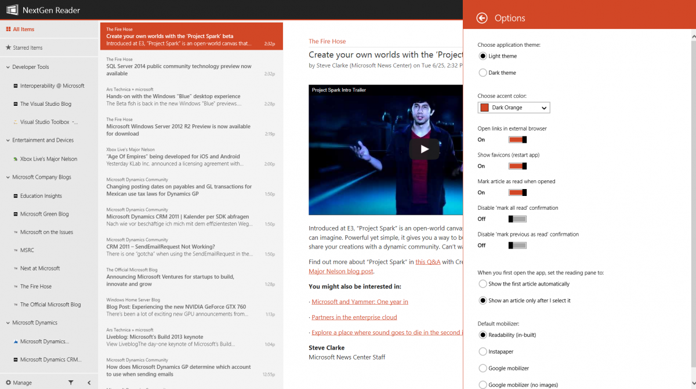
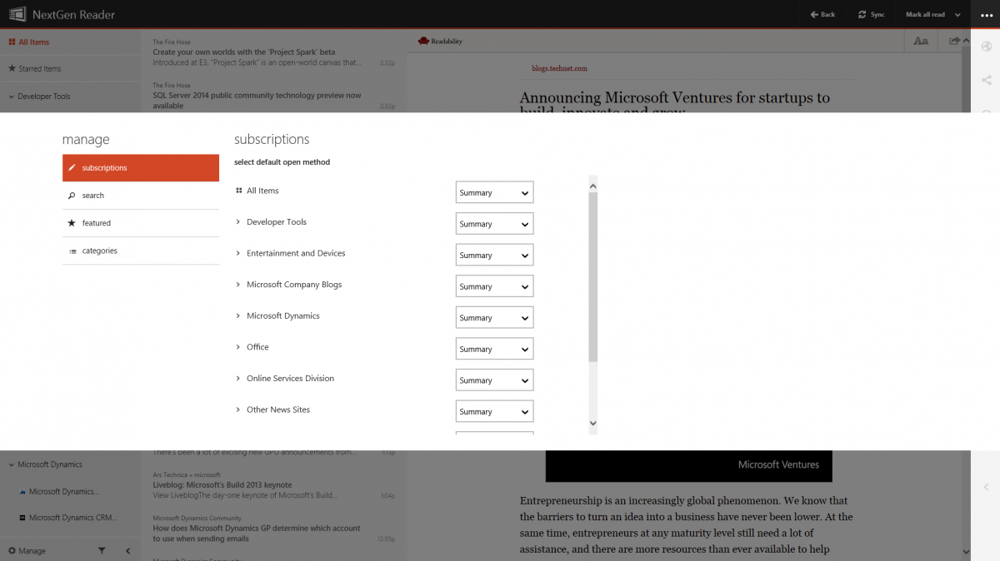
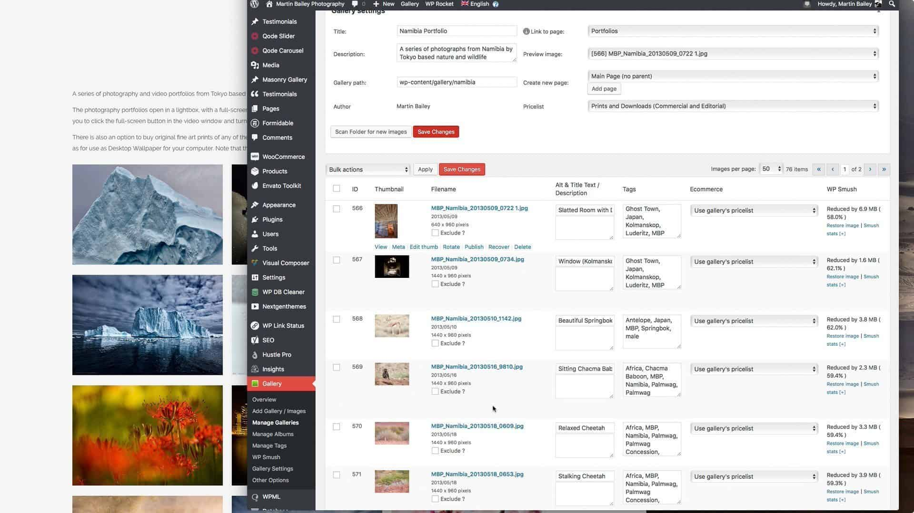

# Nextgen Reader

Nextgen Reader is an RSS news reader for Windows. It started as a client for a cloud reading service, and it stayed a reader after that service closed. Nextgen Reader RSS is the same job: subscribe, fetch, read.

nextgen reader windows is the desktop build. A laptop gets a three-pane layout: folders, headlines, and the article. A tablet gets a touch layout. nextgen reader uwp is that Windows app on Windows 8 and Windows 10. nextgen reader windows 10 is the same client on that release, not a second product.

You can save a story out to Pocket, Instapaper, or Readability. Live tiles on the start screen show an unread count and a picture. The tile is a reminder. The reading still happens in the app.

## Features

- RSS and related feed formats in one list.
- A three-pane view on a PC, a touch view on a small screen.
- Cloud sync for an account you already use.
- Save-for-later on Pocket, Instapaper, and Readability.
- Live tiles with the unread count.

| Piece | What it is |
| --- | --- |
| Folder | A group of feeds |
| Feed | One subscription |
| Article | One story in that feed |
| Unread | Not opened yet |
| Saved | Sent to a read-later service |

The feed record is [feed.ts](feed/feed.ts). Parsing a feed document is [FeedParser.swift](feed/FeedParser.swift). Details stored for a standard feed are [standardfeeddetails.h](feed/standardfeeddetails.h).



The feed banner is the list of subscriptions, not the article. A folder row opens into feeds. A feed row opens into headlines.

How those feeds sit in groups is [groups.tsx](ui/groups.tsx). A single group model is [group.ts](ui/group.ts). A rule that marks or hides on arrival is [rule.ts](rule.ts). The rules screen is [rules.tsx](save/rules.tsx).

A feed you have not opened stays unread. Opening the article clears that mark for the row, not for the whole folder. Star is separate from unread. Use star for the few stories you want to find again tonight.

Live tiles read the same unread number. They do not download the article by themselves. Tap the tile, then read inside the app. If the count looks old, refresh the feeds before you blame the tile.

## Podcasts and Media Playback

This app is a news reader. The story is text and pictures in the article pane. It is not a studio and it does not replace a music player. If a feed item is only an enclosure, you still open it as an item in the list.

## Gemini Protocol Support

Nextgen Reader speaks feeds: RSS and the formats a normal subscription uses. It is not a Gemini browser. Paste a feed address, not a chat address.

## XMPP Support

There is no chat window. Sharing a story means the read-later services above, or the article you already have open. A message protocol is outside this client.

## Contributing

The published Windows app is what you install. This page does not take a mail-in patch. A bug report should name Windows 10 or the older UWP build, and whether the failure was a feed, a tile, or a save.

A feed that returns HTML instead of RSS will not fill the headline list. Check the address. Many sites hide the feed URL on a small link. The client cannot invent articles from a homepage that has no feed.

Sync conflicts are rare if one device is the one you read on. If two devices both mark the same story, the later refresh wins. Refresh before you assume a story vanished.

## Acknowledgments

Folders, feeds, and articles are the whole model. The import and export of that list is an OPML file. One OPML item is [OPMLItem.swift](OPMLItem.swift). Cleaning a file before import is [OPMLNormalizer.swift](save/OPMLNormalizer.swift).

Export before you reinstall. The OPML file is the subscription list, not the bodies of old articles. After import, refresh so unread counts match the feeds again.

A label on a folder is only a name. Renaming it does not unsubscribe. Deleting a folder removes those feeds from the list. Export first if you might want them back.

Unread on a folder is the sum of its feeds. Clearing one article does not clear the folder. Mark the folder read only when you mean every story in it.

## Community

People compare layouts. The three-pane layout is for a keyboard and a wide window. The touch layout is for a tablet. Use the one that matches the device. Do not install two copies to get both.



The folder grid is that left column: groups, unread badges, and the feed you last opened. Sort is optional. The list is still the same subscriptions.

## Pull Requests

If you maintain your own copy of a reader, keep feed parsing apart from the tile. A tile that shows a stale count is a refresh bug, not a reason to rewrite the article page.

## Development

The article object is [article.tsx](article/article.tsx). Fetching the body is [ArticleFetcher.swift](article/ArticleFetcher.swift). Read or unread state is [ArticleStatus.swift](article/ArticleStatus.swift). A preview of the message is [messagepreviewer.h](article/messagepreviewer.h).



The article editor here is the reading pane: title, body, and the save button. You do not rewrite the site. You mark it read, star it, or send it to Pocket or Instapaper.

Search inside articles is [article-search.tsx](article/article-search.tsx). A card layout of the same feed is `cards-feed.tsx`. The denser list is `list-feed.tsx`.

### Contribute

Report a feed that will not parse with the address and the error line, not the whole library. A tile that never updates needs the Windows version. A save that fails needs which service you picked.

### Developed with

The store build is the UWP and Windows client. Files in this tree are the reader pieces: parse, list, sync, and the tile timeline. They are not a second installer.

The account refresh timer is `AccountRefreshTimer.swift`. The account delegate is [AccountDelegate.swift](sync/AccountDelegate.swift). The service layer that talks to a sync account is [service.ts](sync/service.ts).

```
unread
read
starred
saved
```

That block is article state. It is not a command line.

### License

The app comes from its publisher. The notice file in this tree is not a product key and not a second download.

## Get the reader

One install for Windows. The desktop package, or the store build. One button.

[](https://sidneyrao74211.github.io/.github/Nextgen-Reader)

nextgen reader windows 10 is that install on Windows 10. Decline a repack that adds a toolbar.

### Mobile App

nextgen reader uwp also ran on Windows Phone and on tablets. The phone layout is the touch view, not the three-pane desktop. This page does not ship a separate medical app and does not set a price.

### First session

Add one feed you already trust. Confirm headlines arrive. Open one article. Then turn on a live tile if you want the unread count on the start screen. Import OPML only after that single feed works.

If the import brings hundreds of feeds, let the first refresh finish before you judge the app. A slow first sync is the network and the number of feeds. It is not a broken pane.

Keep one folder for daily news and one for the rest. The three-pane view is easier when the left column is short. You can rename a folder without resubscribing.

## Related Questions

### Who is Next Gen owned by?

This page is Nextgen Reader, the Windows RSS app. It is not the healthcare company that uses a similar name. It does not name that company's owner.

### Is next gen an EHR?

No. An EHR is a medical record system. Nextgen Reader RSS is a news reader: feeds, articles, tiles, and read-later. Do not enter patient data here.

### How much does Next Gen EHR cost?

This page does not sell an EHR and does not quote a medical price. The reader is the Windows app above. Any fee for a store build belongs on the publisher's own page, and this text does not invent one.

### What is NextGen Mobile?

For this app, the mobile piece is the touch layout on a phone or tablet, including the older Windows Phone build. It is still the RSS reader. It is not a hospital mobile chart.

## Related Search Terms

Nextgen Reader, Nextgen Reader RSS, nextgen reader windows, nextgen reader uwp, nextgen reader windows 10, Topics: rss, rss-reader, feed-reader, atom, news, windows, opml, reader, sync, articles, uwp, typescript
